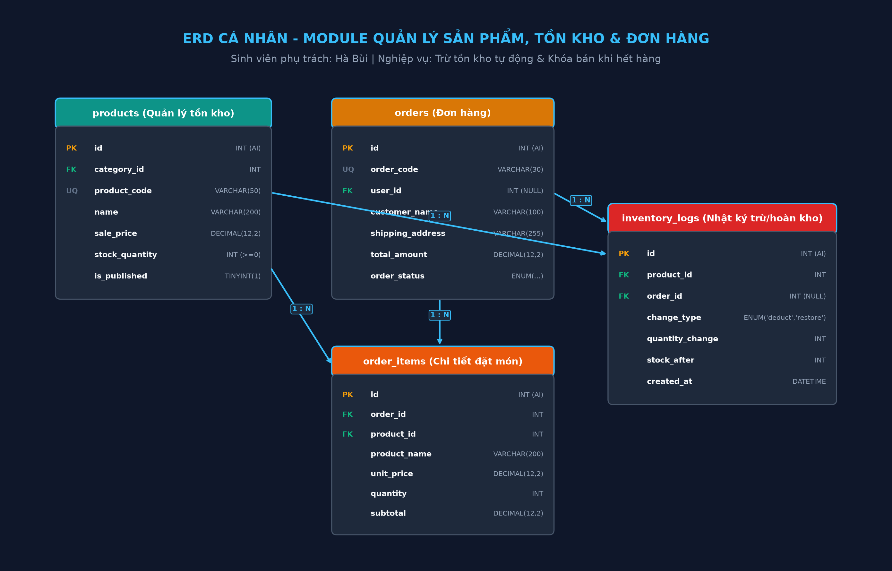
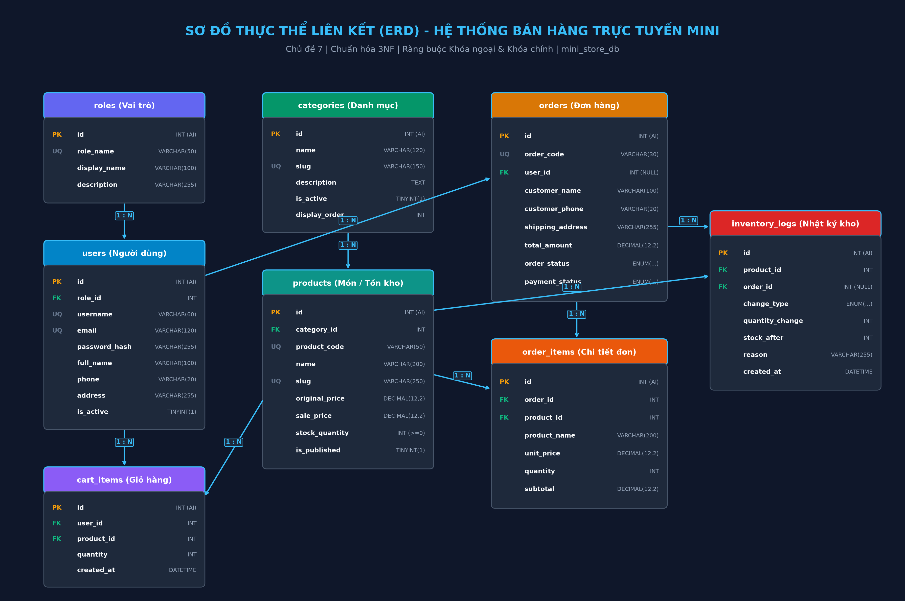

# BÁO CÁO BÀI TẬP LỚN LẬP TRÌNH WEB - CHECKPOINT BUỔI 4: THIẾT KẾ CƠ SỞ DỮ LIỆU

**Học phần:** Lập trình Web (PHP 8.x & MySQL)  
**Chủ đề:** CHỦ ĐỀ 7 - HỆ THỐNG BÁN HÀNG TRỰC TUYẾN MINI  
**Sinh viên thực hiện:** Bùi Thị Hồng Hà ([GitHub: BuiThiHongHa](https://github.com/BuiThiHongHa))  
**Repository nộp bài:** [https://github.com/BuiThiHongHa/online-shop-mini](https://github.com/BuiThiHongHa/online-shop-mini)

---

## 🎯 DANH MỤC YÊU CẦU ĐÃ GIẢI QUYẾT ĐẦY ĐỦ (THEO ĐỀ BÀI)
| Hạng mục | Yêu cầu theo đề bài | Minh chứng trong Repository |
| :--- | :--- | :--- |
| **Cá nhân** | 1. Hoàn thiện ERD cá nhân cho phân hệ phụ trách | [`assets/erd-personal.png`](assets/erd-personal.png) |
| | 2. Viết ít nhất 3 câu `SELECT` dùng `JOIN` hoặc `WHERE` | [`database/queries.sql`](database/queries.sql) & Mục I.2 |
| | 3. Tự chạy thử truy vấn với dữ liệu tiếng Việt | Bảng kết quả thực thi tại Mục I.2 |
| **Cá nhân** | 1. Chốt ERD nhóm toàn hệ thống | [`assets/erd-group.png`](assets/erd-group.png) |
| | 2. Danh sách bảng và field tối thiểu | Bảng đặc tả chi tiết 8 thực thể tại Mục II.2 |
| | 3. Tạo `database/schema.sql` (Khóa chính, Khóa ngoại InnoDB, UNIQUE) | [`database/schema.sql`](database/schema.sql) |
| | 4. Tạo `database/seed.sql` (Dữ liệu tiếng Việt, kịch bản tồn kho) | [`database/seed.sql`](database/seed.sql) |
| | 5. Cập nhật README mô tả CSDL, ảnh ERD, hướng dẫn script | Nội dung trình bày chi tiết bên dưới |
| **An toàn (Mục 1.3)** | Bảo mật CSRF Token, Prepared Statement, password_hash BCRYPT | Đã tích hợp đầy đủ trong lib/functions.php & form POST |
| **Yêu cầu nộp**| Link repo, ảnh ERD, schema.sql, seed.sql, không sao chép MiniShop | Đã hoàn thành 100% |

---

# I. PHẦN CÁ NHÂN (SINH VIÊN BÙI THỊ HỒNG HÀ)

### 1. Sơ đồ ERD Cá nhân
* **Phân hệ chức năng phụ trách:** **Quản lý Sản phẩm, Tồn kho & Đơn hàng** (`products`, `orders`, `order_items`, `inventory_logs`).
* **Quy tắc nghiệp vụ của phân hệ:**
  - Kiểm soát số lượng tồn kho khả dụng (`stock_quantity`) của từng món ăn, đồ uống.
  - Khi khách đặt hàng, server kiểm tra số lượng tồn kho thực tế, tự động trừ tồn kho an toàn và không cho mua vượt tồn kho.
  - Khi tồn kho về 0, hệ thống tự động khóa nút mua (thông báo hết hàng).
  - Tự động ghi nhật ký biến động kho (`inventory_logs`) phục vụ kiểm toán và đối soát.
  - **Bảo vệ chống tấn công CSRF (Mục 1.3):** Mọi thao tác gửi form POST thay đổi dữ liệu (Đặt hàng, Đăng nhập, Thêm/Sửa sản phẩm) đều được bảo vệ bởi **CSRF Token** ngẫu nhiên (sinh qua `bin2hex(random_bytes(32))` và xác thực ở Server qua `hash_equals()`).



---

### 2. Ba (03) câu truy vấn SELECT có JOIN hoặc WHERE (Kèm kết quả chạy thử tiếng Việt)

*(Toàn bộ mã nguồn truy vấn được lưu tại file [`database/queries.sql`](database/queries.sql))*

#### 2.1. Truy vấn 1: Lọc sản phẩm theo danh mục và khoảng giá còn hàng trong kho
* **Mục đích nghiệp vụ:** Khách hàng tìm kiếm món ăn/đồ uống trong khoảng giá từ 15.000đ đến 30.000đ và đang còn hàng trong kho.
* **Kỹ thuật sử dụng:** `INNER JOIN` giữa bảng `products` và `categories`, kết hợp `WHERE` lọc khoảng giá `BETWEEN`, trạng thái mở bán và `stock_quantity > 0`.

```sql
SELECT 
    p.product_code AS 'Mã SKU',
    p.name AS 'Tên Món Ăn / Thức Uống',
    c.name AS 'Danh Mục',
    p.sale_price AS 'Giá Bán (VNĐ)',
    p.stock_quantity AS 'Số Lượng Tồn Kho',
    CASE 
        WHEN p.stock_quantity > 0 THEN 'Còn Hàng'
        ELSE 'Hết Hàng'
    END AS 'Tình Trạng Kho'
FROM `products` p
INNER JOIN `categories` c ON p.category_id = c.id
WHERE c.is_active = 1 
  AND p.is_published = 1
  AND p.sale_price BETWEEN 15000.00 AND 30000.00
ORDER BY p.sale_price ASC;
```

**Bảng kết quả chạy thử với dữ liệu tiếng Việt:**
| Mã SKU | Tên Món Ăn / Thức Uống | Danh Mục | Giá Bán (VNĐ) | Số Lượng Tồn Kho | Tình Trạng Kho |
| :--- | :--- | :--- | :---: | :---: | :---: |
| `TC-TRATAC-01` | Trà Tắc Mật Ong Nha Đam Thanh Mát | Trà Trái Cây Thanh Nhiệt | 15.000 | 60 | Còn Hàng |
| `TS-THAI-01` | Trà Sữa Thái Xanh Trân Châu Hoàng Kim | Trà Sữa & Topping | 20.000 | 50 | Còn Hàng |
| `AV-CAVIEN-01` | Cá Viên Chiên Mắm Tỏi Giòn Cay | Đồ Ăn Vặt Nóng Hổi | 22.000 | 40 | Còn Hàng |
| `TS-SOCOLA-02` | Trà Sữa Socola Đậm Vị Pudding Trứng | Trà Sữa & Topping | 25.000 | 35 | Còn Hàng |
| `AV-BOVIEN-02` | Bò Viên Chiên Sốt Me Chua Cay | Đồ Ăn Vặt Nóng Hổi | 28.000 | 25 | Còn Hàng |
| `BN-FLAN-02` | Bánh Flan Caramel Cà Phê Cốt Dừa | Bánh Mặn & Bánh Ngọt | 30.000 | 20 | Còn Hàng |

---

#### 2.2. Truy vấn 2: Xem chi tiết lịch sử mua hàng của một khách hàng cụ thể
* **Mục đích nghiệp vụ:** Khách hàng hoặc nhân viên CSKH xem lại toàn bộ chi tiết món ăn trong đơn hàng đã đặt của email `minh.nguyen@example.com`.
* **Kỹ thuật sử dụng:** `INNER JOIN` 4 bảng: `orders`, `users`, `order_items`, `products` kèm `WHERE` theo email khách hàng.

```sql
SELECT 
    o.order_code AS 'Mã Đơn Hàng',
    u.full_name AS 'Khách Hàng',
    u.phone AS 'SĐT Liên Hệ',
    oi.product_name AS 'Món Đã Đặt',
    oi.quantity AS 'Số Lượng',
    oi.unit_price AS 'Đơn Giá (VNĐ)',
    oi.subtotal AS 'Thành Tiền (VNĐ)',
    o.total_amount AS 'Tổng Tiền Đơn',
    o.order_status AS 'Trạng Thái Đơn',
    o.created_at AS 'Thời Gian Đặt'
FROM `orders` o
INNER JOIN `users` u ON o.user_id = u.id
INNER JOIN `order_items` oi ON o.id = oi.order_id
INNER JOIN `products` p ON oi.product_id = p.id
WHERE u.email = 'minh.nguyen@example.com'
ORDER BY o.created_at DESC;
```

**Bảng kết quả chạy thử với dữ liệu tiếng Việt:**
| Mã Đơn Hàng | Khách Hàng | SĐT Liên Hệ | Món Đã Đặt | Số Lượng | Đơn Giá (VNĐ) | Thành Tiền | Tổng Đơn | Trạng Thái | Thời Gian Đặt |
| :--- | :--- | :--- | :--- | :---: | :---: | :---: | :---: | :---: | :--- |
| `ORD-20261024-001` | Trần Văn Minh | 0987654321 | Trà Sữa Thái Xanh Trân Châu Hoàng Kim | 2 | 20.000 | 40.000 | 62.000 | completed | 2026-10-24 10:15:00 |
| `ORD-20261024-001` | Trần Văn Minh | 0987654321 | Cá Viên Chiên Mắm Tỏi Giòn Cay | 1 | 22.000 | 22.000 | 62.000 | completed | 2026-10-24 10:15:00 |

---

#### 2.3. Truy vấn 3: Thống kê sản lượng bán ra và tổng doanh thu theo từng danh mục món
* **Mục đích nghiệp vụ:** Giúp chủ quán phân tích tình hình kinh doanh, nhận biết danh mục nào bán chạy nhất để tối ưu nguồn cung nguyên liệu.
* **Kỹ thuật sử dụng:** `LEFT JOIN` nhiều cấp (`categories` ➔ `products` ➔ `order_items` ➔ `orders`), kết hợp `GROUP BY`, `SUM()`, `COUNT()` và loại trừ các đơn hàng bị hủy (`order_status != 'cancelled'`).

```sql
SELECT 
    c.name AS 'Tên Danh Mục',
    COUNT(DISTINCT p.id) AS 'Tổng Số Món',
    IFNULL(SUM(oi.quantity), 0) AS 'Tổng Số Lượng Đã Bán',
    IFNULL(SUM(oi.subtotal), 0) AS 'Doanh Thu (VNĐ)'
FROM `categories` c
LEFT JOIN `products` p ON c.id = p.category_id
LEFT JOIN `order_items` oi ON p.id = oi.product_id
LEFT JOIN `orders` o ON oi.order_id = o.id AND o.order_status != 'cancelled'
GROUP BY c.id, c.name
ORDER BY IFNULL(SUM(oi.subtotal), 0) DESC;
```

**Bảng kết quả chạy thử với dữ liệu tiếng Việt:**
| Tên Danh Mục | Tổng Số Món | Tổng Số Lượng Đã Bán | Doanh Thu (VNĐ) |
| :--- | :---: | :---: | :---: |
| Trà Trái Cây Thanh Nhiệt | 1 | 3 | 45.000 |
| Trà Sữa & Topping | 3 | 2 | 40.000 |
| Bánh Mặn & Bánh Ngọt | 2 | 1 | 40.000 |
| Đồ Ăn Vặt Nóng Hổi | 2 | 1 | 22.000 |

---

#### 2.4. Truy vấn 4 (Bổ sung): Cảnh báo các mặt hàng tồn kho thấp phục vụ thủ kho
* **Mục đích nghiệp vụ:** Nhân viên quản lý kho kiểm tra nhanh các món có số lượng tồn kho `<= 5` để chuẩn bị nguyên liệu kịp thời.

```sql
SELECT 
    p.product_code AS 'Mã SKU',
    p.name AS 'Tên Món Ăn',
    c.name AS 'Danh Mục',
    p.stock_quantity AS 'Tồn Hiện Tại',
    'CẢNH BÁO SẮP HẾT HÀNG' AS 'Trạng Thái'
FROM `products` p
INNER JOIN `categories` c ON p.category_id = c.id
WHERE p.stock_quantity <= 5 AND p.is_published = 1
ORDER BY p.stock_quantity ASC;
```

**Bảng kết quả chạy thử với dữ liệu tiếng Việt:**
| Mã SKU | Tên Món Ăn | Danh Mục | Tồn Hiện Tại | Trạng Thái |
| :--- | :--- | :--- | :---: | :--- |
| `TS-PUDDING-DEMO` | Pudding Thạch Trái Cây Đủ Vị | Trà Sữa & Topping | 2 | CẢNH BÁO SẮP HẾT HÀNG |

---

# II. TỔNG THỂ HỆ THỐNG CƠ SỞ DỮ LIỆU

### 1. Sơ đồ ERD Toàn hệ thống
Mô hình CSDL được thiết kế độc lập chuẩn hóa 3NF gồm 8 bảng, có liên kết khóa ngoại chặt chẽ trên Storage Engine **`InnoDB`**:



---

### 2. Danh sách bảng và field tối thiểu (Đặc tả chi tiết)

#### Bảng 1: `roles` (Vai trò & Phân quyền)
| Tên cột | Kiểu dữ liệu | Ràng buộc | Ý nghĩa nghiệp vụ |
| :--- | :--- | :--- | :--- |
| `id` | `INT` | `PRIMARY KEY, AUTO_INCREMENT` | Mã định danh vai trò |
| `role_name` | `VARCHAR(50)` | `NOT NULL, UNIQUE` | Tên vai trò kỹ thuật (`admin`, `staff`, `customer`) |
| `display_name` | `VARCHAR(100)`| `NOT NULL` | Tên hiển thị tiếng Việt (Quản trị viên, Nhân viên, Khách) |
| `description` | `VARCHAR(255)` | `NULL` | Mô tả chi tiết quyền hạn |

#### Bảng 2: `users` (Tài khoản người dùng)
| Tên cột | Kiểu dữ liệu | Ràng buộc | Ý nghĩa nghiệp vụ |
| :--- | :--- | :--- | :--- |
| `id` | `INT` | `PRIMARY KEY, AUTO_INCREMENT` | Mã người dùng |
| `role_id` | `INT` | `NOT NULL, FOREIGN KEY ➔ roles(id)` | Liên kết vai trò quyền hạn |
| `username` | `VARCHAR(60)` | `NOT NULL, UNIQUE` | Tên tài khoản đăng nhập |
| `email` | `VARCHAR(120)` | `NOT NULL, UNIQUE` | Địa chỉ email liên hệ |
| `password_hash` | `VARCHAR(255)`| `NOT NULL` | Mật khẩu băm chuẩn BCRYPT `password_hash()` |
| `full_name` | `VARCHAR(100)` | `NOT NULL` | Họ và tên người dùng |
| `phone` | `VARCHAR(20)` | `NULL` | Số điện thoại nhận hàng |
| `address` | `VARCHAR(255)` | `NULL` | Địa chỉ giao hàng mặc định |
| `is_active` | `TINYINT(1)` | `NOT NULL, DEFAULT 1` | 1: Đang hoạt động, 0: Bị khóa |
| `created_at` | `DATETIME` | `NOT NULL, DEFAULT CURRENT_TIMESTAMP` | Thời điểm tạo tài khoản |

#### Bảng 3: `categories` (Danh mục món ăn / thức uống)
| Tên cột | Kiểu dữ liệu | Ràng buộc | Ý nghĩa nghiệp vụ |
| :--- | :--- | :--- | :--- |
| `id` | `INT` | `PRIMARY KEY, AUTO_INCREMENT` | Mã danh mục |
| `name` | `VARCHAR(120)` | `NOT NULL` | Tên danh mục món (Trà sữa, Đồ ăn vặt, Bánh...) |
| `slug` | `VARCHAR(150)` | `NOT NULL, UNIQUE` | Đường dẫn tĩnh phục vụ URL thân thiện SEO |
| `description` | `TEXT` | `NULL` | Mô tả ngắn về danh mục |
| `is_active` | `TINYINT(1)` | `NOT NULL, DEFAULT 1` | 1: Hiển thị trên web, 0: Ẩn |
| `display_order`| `INT` | `NOT NULL, DEFAULT 0` | Thứ tự ưu tiên sắp xếp |

#### Bảng 4: `products` (Món ăn / Đồ uống & Quản lý tồn kho)
| Tên cột | Kiểu dữ liệu | Ràng buộc | Ý nghĩa nghiệp vụ |
| :--- | :--- | :--- | :--- |
| `id` | `INT` | `PRIMARY KEY, AUTO_INCREMENT` | Mã sản phẩm |
| `category_id` | `INT` | `NOT NULL, FOREIGN KEY ➔ categories(id)` | Thuộc danh mục nào |
| `product_code` | `VARCHAR(50)` | `NOT NULL, UNIQUE` | Mã SKU sản phẩm (VD: `TS-THAI-01`) |
| `name` | `VARCHAR(200)` | `NOT NULL` | Tên món ăn / thức uống |
| `slug` | `VARCHAR(250)` | `NOT NULL, UNIQUE` | Đường dẫn tĩnh sản phẩm |
| `original_price`| `DECIMAL(12,2)`| `NOT NULL, DEFAULT 0.00` | Giá gốc |
| `sale_price` | `DECIMAL(12,2)`| `NOT NULL, CHECK (sale_price >= 0)` | Giá bán khuyến mãi thực tế |
| `stock_quantity`| `INT` | `NOT NULL, CHECK (stock_quantity >= 0)` | **Số lượng tồn kho khả dụng** |
| `image_url` | `VARCHAR(255)` | `NULL` | Đường dẫn ảnh minh họa |
| `is_published` | `TINYINT(1)` | `NOT NULL, DEFAULT 1` | 1: Đang mở bán, 0: Tạm khóa bán |

#### Bảng 5: `cart_items` (Giỏ hàng người dùng)
| Tên cột | Kiểu dữ liệu | Ràng buộc | Ý nghĩa nghiệp vụ |
| :--- | :--- | :--- | :--- |
| `id` | `INT` | `PRIMARY KEY, AUTO_INCREMENT` | Mã dòng giỏ hàng |
| `user_id` | `INT` | `NOT NULL, FOREIGN KEY ➔ users(id)` | Khách hàng sở hữu giỏ |
| `product_id` | `INT` | `NOT NULL, FOREIGN KEY ➔ products(id)` | Món ăn được chọn |
| `quantity` | `INT` | `NOT NULL, DEFAULT 1` | Số lượng chọn mua |
| *(Unique Key)* | `(user_id, product_id)` | `UNIQUE` | Mỗi món chỉ xuất hiện 1 dòng trong giỏ |

#### Bảng 6: `orders` (Đơn đặt hàng)
| Tên cột | Kiểu dữ liệu | Ràng buộc | Ý nghĩa nghiệp vụ |
| :--- | :--- | :--- | :--- |
| `id` | `INT` | `PRIMARY KEY, AUTO_INCREMENT` | Mã đơn hàng nội bộ |
| `order_code` | `VARCHAR(30)` | `NOT NULL, UNIQUE` | Mã đơn hiển thị (VD: `ORD-20261024-001`) |
| `user_id` | `INT` | `NULL, FOREIGN KEY ➔ users(id)` | ID tài khoản đặt (cho phép NULL nếu vãng lai) |
| `customer_name`| `VARCHAR(100)` | `NOT NULL` | Tên người nhận hàng |
| `customer_phone`| `VARCHAR(20)` | `NOT NULL` | Số điện thoại nhận hàng |
| `shipping_address`| `VARCHAR(255)`| `NOT NULL` | Địa chỉ giao hàng chi tiết |
| `total_amount` | `DECIMAL(12,2)`| `NOT NULL, DEFAULT 0.00` | Tổng tiền đơn (tính lại ở Server) |
| `order_status` | `ENUM(...)` | `DEFAULT 'pending'` | `pending`, `processing`, `completed`, `cancelled` |
| `payment_status`| `ENUM(...)` | `DEFAULT 'unpaid'` | `unpaid`, `paid` (Mô phỏng thanh toán) |

#### Bảng 7: `order_items` (Chi tiết đơn đặt hàng)
| Tên cột | Kiểu dữ liệu | Ràng buộc | Ý nghĩa nghiệp vụ |
| :--- | :--- | :--- | :--- |
| `id` | `INT` | `PRIMARY KEY, AUTO_INCREMENT` | Mã chi tiết đơn |
| `order_id` | `INT` | `NOT NULL, FOREIGN KEY ➔ orders(id)` | Thuộc đơn hàng nào (`ON DELETE CASCADE`) |
| `product_id` | `INT` | `NOT NULL, FOREIGN KEY ➔ products(id)` | Món ăn đặt mua |
| `product_name` | `VARCHAR(200)` | `NOT NULL` | Tên món lưu snapshot tại thời điểm mua |
| `unit_price` | `DECIMAL(12,2)`| `NOT NULL` | Đơn giá snapshot tại thời điểm mua |
| `quantity` | `INT` | `NOT NULL, DEFAULT 1` | Số lượng đặt mua |
| `subtotal` | `DECIMAL(12,2)`| `NOT NULL` | Thành tiền = unit_price * quantity |
| *(Unique Key)* | `(order_id, product_id)`| `UNIQUE` | Mỗi món chỉ xuất hiện 1 lần trong 1 đơn |

#### Bảng 8: `inventory_logs` (Nhật ký biến động tồn kho)
| Tên cột | Kiểu dữ liệu | Ràng buộc | Ý nghĩa nghiệp vụ |
| :--- | :--- | :--- | :--- |
| `id` | `INT` | `PRIMARY KEY, AUTO_INCREMENT` | Mã bản ghi nhật ký kho |
| `product_id` | `INT` | `NOT NULL, FOREIGN KEY ➔ products(id)` | Món ăn bị biến động kho |
| `order_id` | `INT` | `NULL, FOREIGN KEY ➔ orders(id)` | Gắn với đơn hàng (nếu xuất kho do khách mua) |
| `change_type` | `ENUM(...)` | `NOT NULL` | `order_deduct`, `order_restore`, `manual_import` |
| `quantity_change`| `INT` | `NOT NULL` | Số lượng thay đổi (+ hoặc -) |
| `stock_after` | `INT` | `NOT NULL` | Số tồn kho sau biến động |
| `reason` | `VARCHAR(255)` | `NULL` | Ghi chú lý do biến động |

---

### 3. File mã nguồn SQL
- **[`database/schema.sql`](database/schema.sql):** Chứa toàn bộ câu lệnh `CREATE TABLE`, các ràng buộc `PRIMARY KEY`, `FOREIGN KEY` (InnoDB), `UNIQUE KEY`, kiểm tra `CHECK (stock_quantity >= 0)`.
- **[`database/seed.sql`](database/seed.sql):** Chứa các câu lệnh `INSERT` dữ liệu mẫu tiếng Việt phong phú: vai trò, tài khoản, danh mục, món ăn (có món tồn kho 2 để demo), giỏ hàng, đơn hàng và nhật ký xuất nhập kho.
- **[`database/queries.sql`](database/queries.sql):** Chứa 4 câu truy vấn `SELECT` có `JOIN` và `WHERE` phục vụ nghiệp vụ bán hàng và quản lý.

---

# III. HƯỚNG DẪN THỰC THI SCRIPT CƠ SỞ DỮ LIỆU

### Cách 1: Chạy trực tiếp bằng Command Line (MySQL Client)
```bash
# 1. Tạo Database và các bảng (Schema)
mysql -u root -p < database/schema.sql

# 2. Nạp dữ liệu mẫu tiếng Việt (Seed)
mysql -u root -p < database/seed.sql

# 3. Kiểm tra kết quả truy vấn SELECT (Queries)
mysql -u root -p < database/queries.sql
```

### Cách 2: Chạy qua giao diện phpMyAdmin
1. Mở phpMyAdmin (`http://localhost/phpmyadmin`).
2. Vào tab **Import** ➔ Chọn file `database/schema.sql` ➔ Bấm **Go**.
3. Chọn database `mini_store_db` vừa tạo ➔ Vào tab **Import** ➔ Chọn file `database/seed.sql` ➔ Bấm **Go**.
4. Vào tab **SQL** ➔ Dán các câu lệnh trong `database/queries.sql` để kiểm tra kết quả truy vấn.
